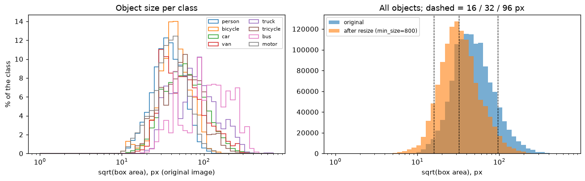
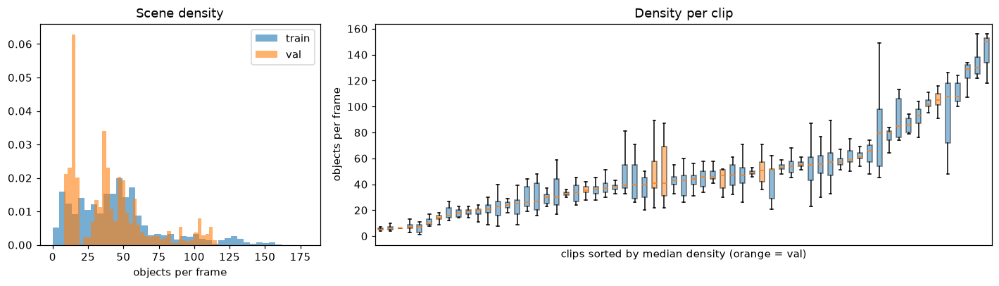
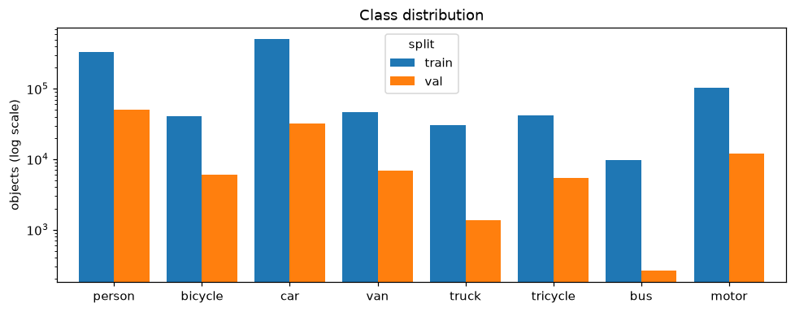
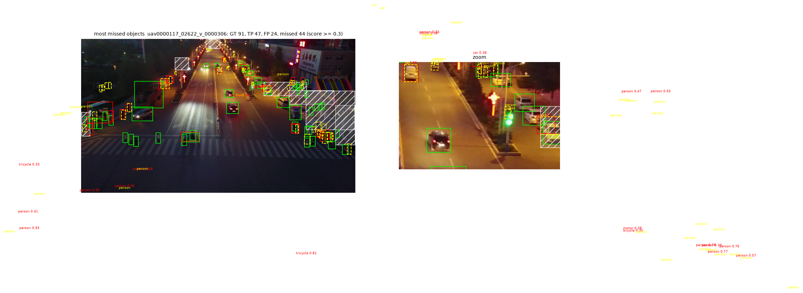
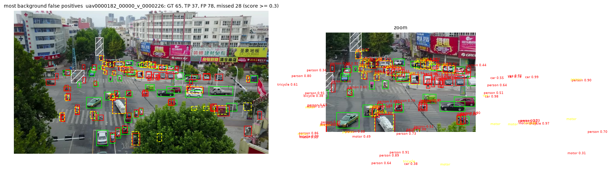
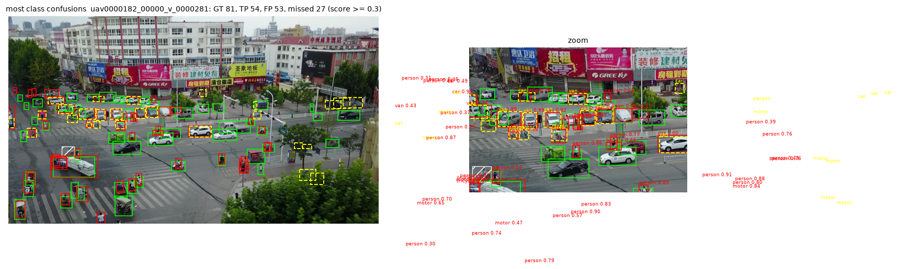
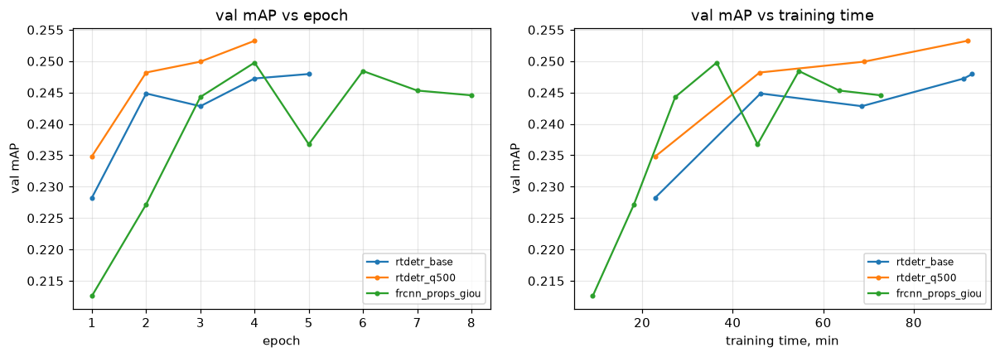

## Introduction

Write your report here using regular **Markdown**. This text is an example — replace it.

## Method

### Data analysis and preprocessing

<!-- object sizes -> small objects; aspect ratios -> anchor ratios kept -->



*Figure 1. Object size (√area) per class in original pixels (left) and for all objects before and after resizing to 800 px (right); dashed lines mark 16 / 32 / 96 px.*


<!-- density across clips -> split by clip, 500 detections per image, 500 queries -->



*Figure 2. Objects per frame in train and val (left) and per clip, sorted by median density (right; orange = validation clips).*

<!-- class imbalance, rare bus -->



*Figure 3. Number of objects per class in the training and validation sets (log scale).*

<!-- ignored regions, conversion check, split by clip, frame subsampling, resize and augmentation -->

### Training protocol

<!-- shared settings, optimisers, evaluation, noise level, deviations (T4 vs GTX 1660, RT-DETR budget and fp32) -->

### Detectors

#### Two-stage anchor-based: Faster R-CNN

<!-- model, tuned parameters: RPN proposals, GIoU box loss -->

#### One-stage anchor-based: RetinaNet

<!-- anchor coverage analysis, tuned parameters: anchor sizes, focal gamma -->

#### One-stage anchor-free: FCOS

<!-- location assignment, simulation, tuned parameters: P2 level, CIoU loss -->

#### Query-based: RT-DETR

<!-- bipartite matching and no NMS, number of queries vs density -->

### Pipeline

<!-- part A: score threshold, NMS, flip TTA; part B: smaller anchors (B1), ensemble with RT-DETR (B2) -->

## Results

### Required detectors

**Table 1.** Validation results of all required detectors (same frames, same metric; the best epoch by val mAP is kept).

| Model | Family | mAP | AP50 | AP_small | AP_large | AR | Best epoch |
|---|---|---|---|---|---|---|---|
| frcnn_base | two-stage | 0.246 | 0.478 | 0.105 | 0.451 | 0.350 | 6 |
| frcnn_props | two-stage | 0.242 | 0.494 | 0.137 | 0.422 | 0.390 | 3 |
| frcnn_props_giou | two-stage | 0.250 | 0.494 | 0.121 | 0.435 | 0.399 | 4 |
| retina_base | one-stage, anchors | 0.193 | 0.369 | 0.078 | 0.355 | 0.357 | 8 |
| retina_anchors | one-stage, anchors | 0.171 | 0.367 | 0.070 | 0.301 | 0.383 | 8 |
| retina_anchors_focal | one-stage, anchors | 0.179 | 0.381 | 0.069 | 0.324 | 0.379 | 8 |
| fcos_base | anchor-free | 0.190 | 0.375 | 0.094 | 0.344 | 0.406 | 4 |
| fcos_p2 | anchor-free | 0.196 | 0.390 | 0.089 | 0.365 | 0.428 | 6 |
| fcos_p2_ciou | anchor-free | 0.194 | 0.388 | 0.094 | 0.361 | 0.433 | 6 |
| rtdetr_base | query-based | 0.248 | 0.489 | 0.128 | 0.417 | 0.489 | 5* |
| rtdetr_q500 | query-based | 0.253 | 0.501 | 0.130 | 0.418 | 0.480 | 4* |

\* RT-DETR runs were stopped by the 90-minute training budget after 4–5 of 8 epochs.

#### Faster R-CNN

<!-- what the RPN and the second stage contribute (proposal recall), effect of more proposals and GIoU -->

#### Failure cases

<!-- case 1: missed small and occluded objects -->



*Figure 4. Failure case 1 — the validation frame with the most missed objects (Faster R-CNN, score ≥ 0.3). Green: correct detections, red: false positives, yellow dashed: missed objects, grey: ignored regions.*


<!-- case 2: background false positives -->



*Figure 5. Failure case 2 — the frame with the most false positives on background (same colours as in Figure 4).*

<!-- case 3: confusion of similar classes, bus -->



*Figure 6. Failure case 3 — the frame with the most class confusions (same colours as in Figure 4).*

#### RetinaNet

<!-- removing the proposal stage: class imbalance and focal loss, no box refinement; smaller anchors vs results; comparison with Faster R-CNN -->

#### FCOS

<!-- search range, selected settings, results by object size, comparison with anchor-based models -->

#### RT-DETR

<!-- convergence within the budget, comparison with the CNN, small objects and dense scenes -->



*Figure 7. Validation mAP during training: RT-DETR (300 and 500 queries) vs the best CNN (frcnn_props_giou), by epoch (left) and by training time (right). RT-DETR was trained on a slower GPU in fp32.*

### Pipeline

**Table 2.** Pipeline steps on the validation set. Steps A change only inference (same weights); steps B change the model.

| Step | Change | val mAP | AP_small | AR |
|---|---|---|---|---|
| 0 | frcnn_props_giou as trained | 0.250 | 0.121 | 0.399 |
| A1 | score ≥ 0.001, ≤ 500 dets, NMS 0.5 | 0.256 | 0.125 | 0.457 |
| A2 | NMS 0.6 / 0.7 | 0.256 / 0.249 | 0.126 / 0.124 | 0.465 / 0.469 |
| A3 | + horizontal-flip TTA | 0.255 | 0.122 | 0.466 |
| B1 | smaller RPN anchors (16–256 px) | 0.227 | 0.120 | 0.343 |
| B2 | A1 + rtdetr_q500 ensemble, NMS 0.6 | **0.266** | **0.143** | **0.497** |

<!-- what helped in part A, why B1 failed, why the ensemble works -->

**Table 3.** Kaggle submissions (public leaderboard).

| Submission | Public score |
|---|---|
| Baseline | 0.2216 |
| frcnn_props_giou (as trained) | 0.2242 |
| Final: Faster R-CNN (A1) + RT-DETR q500 ensemble, ≤ 300 dets/image | **0.2820** |
| Faster R-CNN (A1), ≤ 500 dets/image | scoring error (file too large) |

### Unsuccessful attempts

<!-- smaller anchors (RetinaNet, B1), P2 and CIoU in FCOS, flip TTA, fp16 on the local GPU, 500-detection submission -->

## Conclusion

<!-- 3-4 main findings and next steps -->

### Final model and how to run

<!-- which models, inference settings and merging form the final submission (notebook section 9.4) -->

<!-- ```bash
pip install torch==2.6.0 torchvision==0.21.0 --index-url https://download.pytorch.org/whl/cu124
pip install -r requirements.txt
``` -->
