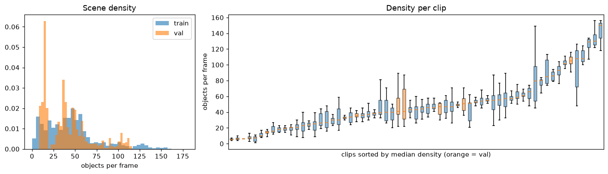
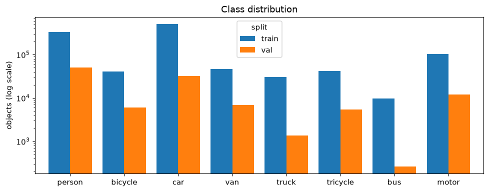
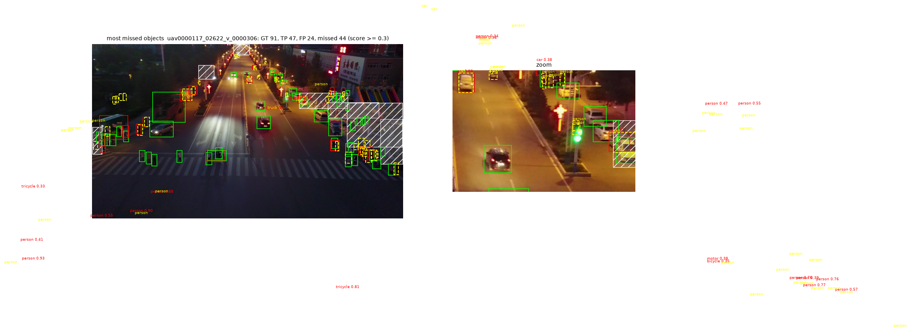

## Introduction

The core task of this homework is to develop a deep learning model capable of accurately identifying objects across the video. The objects are split into 8 different classes: person, bicycle, car, van, truck, tricycle, bus, motor. For detection, 4 algorithms were chosen: One-stage Anchor-based, Two-stage Anchor-based, One-stage Anchor-free and query-based. Also a custom pipeline was developed, which will be explained more broadly in separate section.

The models were trained mainly on a T4 GPU in Google Colab and on an NVIDIA GeForce GTX 1660 SUPER. The mAP@[.5:.95] metric was chosen to compare the models. The models are run and visualized in `hw2_detection.ipynb`, while `hw2_detection.py` contains all helper functions and models.

The final submission (two models ensemble) scored **0.282** on the Kaggle public leaderboard, which beats the baseline of **0.222**.

## Method

### Data analysis and preprocessing

The data is represented as clips and frames. In total there are **56** / **24,201** clips/frames in train data, **48** / **3,811** clips/frames in test data and **7** / **2,846** clips/frames in validation data. Resolution varies (from **680x382** to **1920x1080**).

After resizing each frame to 800px, the median object size (√area) is equal to ~32px. 50% of objects are <32px and only 5% <14px (Figure 1). Also, 80% of boxes have h/w in 0.48–2.28, so default anchor ratios (0.5, 1, 2) were kept.

In conclusion, the smallest objects become the biggest problems. To address this, we monitored *AP_small*, tuned anchors and added a P2 level.


*Figure 1. Object size (√area) per class in original pixels (left) and for all objects before and after resizing to 800 px (right); dashed lines mark 16 / 32 / 96 px.*

Object density varies strongly between different clips (from **0** to **180** objects per frame). The median is **43** objects per frame. Frames from two distinct clips differ in density much more than frames from the same clip. As a result, the data is split by clip to prevent leakage of data. Also, due to high density there are up to 500 detections per image and 500-query RT-DETR variant.



*Figure 2. Objects per frame in train and val (left) and per clip, sorted by median density (right; orange = validation clips).*

The classes are not distributed equally. Classes `person` and `car` are the most frequent, while `bus` is the rarest.



*Figure 3. Number of objects per class in the training and validation sets (log scale).*

**Ignored regions:** in VisDrone clips, there are areas where objects aren't annotated due to their small size or their large number (crowds of people). Also class `others` fits here. Ignoring this will make the model treat groups of unlabelled but relevant objects as background.

In order to prevent this:
- **during training:** such areas are filled with grey. Also GT boxes mostly inside these areas are dropped.
- **during validation:** detections that lie mostly within an ignored region are ignored before calculating mAP. The only exception is a detection which matches an annotated box.

**Conversion check:** verified visually by drawing the boxes around objects and automatically by comparing them with annotations in COCO format on 200 random frames (the number of boxes match and IoU ≈ 1). 

**Split by clip:** the official train/val split was used. All clips were checked for overlap: none appears in both.

**Frame subsampling:** in order to make training faster and easier only every 10th frame was used. After 1 frame **95%** of boxes stay in place, compared to only **21%** after 10 frames. In validation data every 5th frame was used. This leaves ~2,400 training and ~570 validation frames.

**Resize and augmentation:** every frame is resized to 800px (short side) and <= 1333px (long side), proportions remain the same. For data augmentation only horizontal flip with probability of 0.5 was used.

**Normalization:** ImageNet mean/std inside torchvision models, 0–1 input for RT-DETR.

### Training protocol

Every detector used the same protocol: COCO-pretrained weights, the same validation and train frames, 8 epochs, an effective batch of 4 and seed 42. CNNs were trained with SGD (lr 0.005, cosine schedule, mixed precision), RT-DETR with AdamW (lr 1e-4, backbone ×0.1). After every epoch the model was evaluated on validation data and the best epoch was kept. Changes in mAP smaller than ±0.01 are treated as noise. All CNNs were trained on a Colab T4, while RT-DETR was trained locally on a GTX 1660 SUPER in fp32 (fp16 gave NaN losses) with a 90-minute budget per run.

### Detectors

#### Two-stage anchor-based: Faster R-CNN

A COCO-pretrained torchvision `fasterrcnn_resnet50_fpn_v2` was used with a new classifier for 8 classes. Two changes were tested in turn: more RPN proposals (from 2000 to 3000 in training and from 1000 to 2000 during testing) and a GIoU box loss in the second stage instead of smooth-L1.

#### One-stage anchor-based: RetinaNet

`retinanet_resnet50_fpn_v2` was used. Anchor sizes were chosen from an anchor-coverage check. With anchors from **32px**, only 25% of small and none of the tiny objects could reach IoU >= 0.5. However, with anchors from **16px**, the numbers grew to **95%** and **55%**. For this task anchor sizes were tuned from 32–512 to 16–256 px and focal loss gamma was changed (2.0 -> 1.5).

#### One-stage anchor-free: FCOS

In FCOS a feature-map location is positive for a box if it lies inside it, is close to the centre of the box and the box fits the FPN level. A simulation of this rule (with the default levels of P3-P7) showed that 18.6% of tiny objects get no positive location, but an extra P2 level drops this number to 1.5%. The P2 level (off/on) and the box loss (GIoU -> CIoU) were tuned.

#### Query-based: RT-DETR

`PekingU/rtdetr_r50vd` from Hugging Face was used. Thanks to a one-to-one matching between objects and queries, the model produces no duplicates and doesn't require NMS. As frames may contain up to 180 objects, 300 queries give only ~2 queries per object in the densest frames, so 500 queries were tested.

### Pipeline

The pipeline is based on the best required CNN, `frcnn_props_giou`, and the same validation frames are used for measuring steps. 
- **Part A:** changes only for inference. A lower score threshold (0.001) with up to 500 detections per frame (A1), the NMS threshold 0.5 / 0.6 / 0.7 (A2) and horizontal flip augmentation combined with NMS (A3).
- **Part B:** changes the model itself. Smaller RPN anchors (16-256px) with the same protocol (B1). Also, an ensemble of Faster R-CNN (with A1) and RT-DETR q500, merged with class-wise NMS (B2).

## Results

### Required detectors

**Table 1.** Validation results of all required detectors (same frames, same metric; the best epoch by val mAP is kept).

| Model | Family | mAP | AP50 | AP_small | AP_large | AR | Best epoch |
|---|---|---|---|---|---|---|---|
| frcnn_base | two-stage | 0.246 | 0.478 | 0.105 | 0.451 | 0.350 | 6 |
| frcnn_props | two-stage | 0.242 | 0.494 | 0.137 | 0.422 | 0.390 | 3 |
| frcnn_props_giou | two-stage | 0.250 | 0.494 | 0.121 | 0.435 | 0.399 | 4 |
| retina_base | one-stage, anchors | 0.193 | 0.369 | 0.078 | 0.355 | 0.357 | 8 |
| retina_anchors | one-stage, anchors | 0.171 | 0.367 | 0.070 | 0.301 | 0.383 | 8 |
| retina_anchors_focal | one-stage, anchors | 0.179 | 0.381 | 0.069 | 0.324 | 0.379 | 8 |
| fcos_base | anchor-free | 0.190 | 0.375 | 0.094 | 0.344 | 0.406 | 4 |
| fcos_p2 | anchor-free | 0.196 | 0.390 | 0.089 | 0.365 | 0.428 | 6 |
| fcos_p2_ciou | anchor-free | 0.194 | 0.388 | 0.094 | 0.361 | 0.433 | 6 |
| rtdetr_base | query-based | 0.248 | 0.489 | 0.128 | 0.417 | 0.489 | 5* |
| rtdetr_q500 | query-based | 0.253 | 0.501 | 0.130 | 0.418 | 0.480 | 4* |

\* RT-DETR runs were stopped by the 90-minute training budget after 4–5 of 8 epochs.

#### Faster R-CNN

The upper bound is set by the RPN: proposal recall (IoU >= 0.5) grows from 66% for the top-100 to 87% for the top-2000 proposals and from 56% to 77% for small objects. At the second stage objects are filtered and classified, dropping recall to 79% for any class and 76% for the correct class. With more proposals *AP_small* was raised from 0.105 to 0.137 at the same *mAP*, but the speed slowed down (13 -> 10 img/s). Adding GIoU gave the best *mAP* of 0.250.

#### Failure cases

Small and obstructed objects are missed most often: recall drops from 0.90 for large to 0.52 for small and 0.13 for tiny objects; from 0.81 for objects that aren't obstructed to 0.22 for heavily obstructed objects.



*Figure 4. Failure case 1 — the validation frame with the most missed objects (Faster R-CNN, score ≥ 0.3). Green: correct detections, red: false positives, yellow dashed: missed objects, grey: ignored regions.*

Roofs, shadows or road marks sometimes look like objects from above: 22% of all predictions are such FP on background (Figure 5).


*Figure 5. Failure case 2 — the frame with the most false positives on background (same colours as in Figure 4).*

Similar classes are sometimes confused: `motor` and `person` (610 cases, as a rider and a motorbike share one box), `van` and `car` (715), `bicycle` and `motor` (383). With only 53 validation instances, `bus` has recall 0, being predicted as a `car`, `van` or `truck` (Figure 6).


*Figure 6. Failure case 3 — the frame with the most class confusions (same colours as in Figure 4).*

#### RetinaNet

RetinaNet scores ~100k anchors directly without a proposal stage and almost all of them are background. Focal loss helps handle this imbalance, but the box refinement is absent, so localization is worse (*AP75* 0.180 vs 0.222). Shrinking anchors improved coverage. However, *mAP* (0.193 -> 0.171) and *AP_large* (0.355 -> 0.300) dropped because large objects lost the biggest anchors. Gamma 1.5 recovered part of the drop to 0.179. Compared to Faster R-CNN, RetinaNet is ~1.8x faster and has lower *mAP* (0.193 vs 0.250).

#### FCOS

The search covered the P2 level (off/on) and the box loss (GIoU/CIoU). Neither change clearly improved *mAP* nor *AP_small*, only *AP_large* grew (from 0.344 to 0.365). The loss was still falling at epoch 8, so randomly initialised P2 layers may need more epochs.

With *mAP* of 0.19-0.20, FCOS is on the same level as RetinaNet and below Faster R-CNN (0.250).

#### RT-DETR

The 90-minute budget interrupted runs after 4-5 epochs, while the loss was still falling. Despite this, RT-DETR matches the best CNN (0.253 vs 0.250) and is ahead of it at every epoch (Figure 7). Without NMS it keeps neighbouring objects, so *mAP* is better for the densest frames (0.356 vs 0.350) and overall *AR* is higher (0.48 vs 0.40). Also, 500 queries added +0.005 *mAP*.


*Figure 7. Validation mAP during training: RT-DETR (300 and 500 queries) vs the best CNN (frcnn_props_giou), by epoch (left) and by training time (right). RT-DETR was trained on a slower GPU in fp32.*

### Pipeline

**Table 2.** Pipeline steps on the validation set. Steps A change only inference (same weights); steps B change the model.

| Step | Change | val mAP | AP_small | AR |
|---|---|---|---|---|
| 0 | frcnn_props_giou as trained | 0.250 | 0.121 | 0.399 |
| A1 | score ≥ 0.001, ≤ 500 dets, NMS 0.5 | 0.256 | 0.125 | 0.457 |
| A2 | NMS 0.6 / 0.7 | 0.256 / 0.249 | 0.126 / 0.124 | 0.465 / 0.469 |
| A3 | + horizontal-flip TTA | 0.255 | 0.122 | 0.466 |
| B1 | smaller RPN anchors (16–256 px) | 0.227 | 0.120 | 0.343 |
| B2 | A1 + rtdetr_q500 ensemble, NMS 0.6 | **0.266** | **0.143** | **0.497** |

- **A1** gave +0.006 mAP and +0.058 AR without retraining. NMS 0.6 equalled 0.5, while 0.7 added duplicates. Flip TTA didn't help, because NMS keeps one of the two shifted boxes instead of averaging them.
- **B1** was worse: large objects lost the 512-px anchors, while small ones already received proposals.
- **B2** was best with +0.010 over A1, since the CNN and the transformer make different errors.

**Table 3.** Kaggle submissions (public leaderboard).

| Submission | Public score |
|---|---|
| Baseline | 0.2216 |
| frcnn_props_giou (as trained) | 0.2242 |
| Final: Faster R-CNN (A1) + RT-DETR q500 ensemble, ≤ 300 dets/image | **0.2820** |
| Faster R-CNN (A1), ≤ 500 dets/image | scoring error (file too large) |

### Unsuccessful attempts

- Smaller anchors in RetinaNet and Faster R-CNN (B1).
- P2 level and CIoU loss in FCOS (no significant gain).
- Horizontal-flip TTA.
- fp16 training on the local GTX 16xx GPU: NaN losses in RT-DETR and mAP 0.000 for B1 (the same code reached 0.227 on a T4).
- A submission with 500 detections per image (Kaggle internal scoring error).

## Conclusion

One of the biggest problems was small and tiny objects, which were hard to detect. Surprisingly, shrinking anchors didn't help and only made the situation worse for large objects. However, more proposals (*AP_small* from 0.105 to 0.137) and the ensemble improved the situation (0.143).
Faster R-CNN and RT-DETR turned out much better than one-stage CNNs (~0.25 vs ~0.19). RT-DETR even reached this level without converging.
The pipeline gave us the expected result: changing inference was cheap and didn't require any training (giving +0.006). On the other hand, the ensemble gave the biggest gain (+0.010 val).

### Final model and how to run

The final submission is an ensemble of `frcnn_props_giou` (score ≥ 0.001, NMS 0.5) and `rtdetr_q500`, merged with class-wise NMS 0.6 and limited to 300 detections per image (notebook section 9.4).

```bash
pip install torch==2.6.0 torchvision==0.21.0 --index-url https://download.pytorch.org/whl/cu124
pip install -r requirements.txt
```

All runs use seed 42; each run's settings are saved in `results/<run>/config.json`. A CUDA GPU is required for training (GPUs without fp16 support may need `amp=False`).
